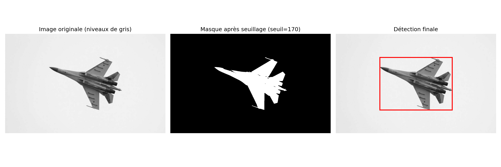

# Détection d'avions — Su-35S

Mini-projet de traitement d'image en Python : détecter un avion de chasse sur une photo.

## Objectif
L'enjeu de ce programme est de condenser des opérations de comparaisons de seuil d'image pour utiliser les opérations de Broadcasting et Boléean Indexing afin d'optimiser les traitements préliminaires réalisés en computer vision.
les objectifs sont simples :
- Réaliser un programme court et clair pour détecter la présence d'un avion / objet sur une image,
- Utiliser le broadcasting et le seuillage pour situer l'objet dans l'image
- Isoler la zone pour envisager par la suite des travaux plus poussés sur l'identification de l'objet.

## Méthode
La méthode d'analyse est la suivante :
- Définition du chemin d'accès des fichiers
- Observation de l'image
- Normalisation en niveaux de gris (réduction de dimension pour facilier le traitement)
- Histogramme des niveaux de gris (étape centrale pour définir le seuil de détection)
- Booléan Indexing : Seuillage et filtrage de l'image
- Nettoyage des artefacts (points/trous isolés) avec les méthodes binary_opening et binary_closing
- Définition des bornes extremums de l'objet sur l'image et encadrement de l'objet.

## Résultats

La détection fonctionne dans le cadre d'une image simplifiée sur fond clair de l'avion de chasse. Cependant, le modèle voit ses limites arriver rapidement en cas de paysage sombre ou avec plus de reliefs colorimétrique. Le seuillage ne permet plus de faire la différence avec le fond de l'image et la totalité de l'iamge est détectée comme objet, ce qui n'a plus d'intérêt dans ce contexte.

## Contenu du dépôt
- `Aircraft_Detection_Miniproject.ipynb` : notebook principal
- `Image_Processing.ipynb` : (à préciser)
- `requirements.txt` : dépendances Python

## Installation
    pip install -r requirements.txt
